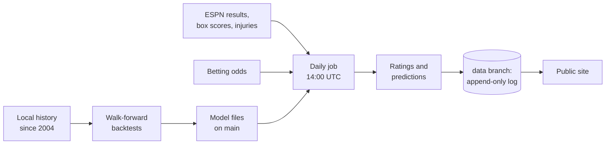

# NBA Forecast

[](https://github.com/garettprestholdt/nba-forecast/actions/workflows/ci.yml)
[](https://github.com/garettprestholdt/nba-forecast/actions/workflows/daily.yml)
[](https://garettprestholdt.github.io/nba-forecast/)
[](LICENSE)

**Daily NBA win probabilities, published before tip-off and scored in public.** Every forecast
is committed to git with a timestamp before the game starts, so the track record can't be
edited after the fact. New models earn promotion only by beating a rule written down before
their first live prediction.

**[Live site](https://garettprestholdt.github.io/nba-forecast/)** ·
**[Prediction log](https://github.com/garettprestholdt/nba-forecast/tree/data)** ·
**[Findings](docs/findings/)** · **[How to reproduce](docs/reproduce.md)**

## Results
Held out: every game of the 2020-21 to 2025-26 seasons (7,776 games), predicted walk-forward
from data available before each tip-off. Lower log-loss is better.

| Model | Status | Log-loss | Brier | Accuracy |
|---|---|---|---|---|
| Coin flip | baseline | 0.6931 | 0.2500 | 50.0% |
| Elo, adaptive home court | **published** | 0.6254 | 0.2180 | 65.0% |
| Hybrid v1: team history + player box scores | in shadow | 0.6171 | 0.2142 | 66.0% |
| Hybrid v2: + RAPM defense and the injury report | in shadow | 0.6074* | 0.2104 | 66.4% |

\*v2's features were chosen after comparing ten candidates on these same seasons, so its
held-out number is optimistic. Its pre-registered live window (the 2026-27 regular season) is
the real test: [promotion bar](docs/promotion-bar-hybrid-v2.md). The live season scorecard,
including the betting market, is on the [model page](https://garettprestholdt.github.io/nba-forecast/model.html).

What the research found, one write-up per decision:
- [Home-court advantage drifted](docs/findings/elo-backtest.md); a fixed Elo bonus miscalibrates.
- [Rest matters; the model family doesn't](docs/findings/kalman-vs-elo.md) (Kalman vs. Elo).
- [Players add signal to team history](docs/findings/hybrid-model.md), and knowing who's out adds as much again.
- [Defense ratings and who's missing help](docs/findings/impact-challenger.md); a multicollinearity and overfitting review.
- [Blank box scores can be rebuilt from play-by-play](docs/findings/pbp-box-rebuild.md), and checked.

## On the site
- **Tonight:** every game's forecast from each model next to the betting market, live scores,
  and key players with projected Game Scores.
- **Game pages:** arena, team stats side by side, and half-court shot charts for each team's
  shots and the shots it allows.
- **Player profiles:** age, offense and defense impact (RAPM), defensive role, shot chart, game
  log and career.
- **Teams:** rating history explained game by game, strengths and weaknesses, roster, full schedule.
- **Standings and playoff odds** from 10,000 simulated seasons, **prediction history**, and
  **Cold Case**, a daily whodunit built from real play-by-play.

## How it works


- **No leakage:** features use only data from before tip-off; backtests are walk-forward.
- **Append-only record:** `nbaf verify` blocks edits to past predictions and anything logged
  after tip-off before the daily job commits; the `data` branch can't be force-pushed.
- **Pre-registered promotion:** challengers run in shadow next to the published model and are
  promoted only by a rule fixed before their first live prediction.
- **AI agents, checked by code:** Claude writes the morning recap, estimates whether injured
  players will play, and triages failed runs. Each draft is checked by deterministic code
  before anything is published, and agents never commit.

## Reproduce
Requires Python 3.12+ and [uv](https://docs.astral.sh/uv/). Dependencies are pinned in `uv.lock`.

```bash
make setup      # install pinned dependencies and git hooks
make check      # lint + 340 tests (no network)
make reproduce  # rebuild every published number from public data (~6 h the first time)
```

Each stage (`data`, `plays`, `backtests`, `models`, `site`) is its own target; `make help`
lists them and [docs/reproduce.md](docs/reproduce.md) explains what each writes.

## Repository
```
src/nbaforecast/   the package: ingest/ · models/ · pipeline/ · agents/ · research/ · games/ · web/ · cli/
dbt/               warehouse models and data tests
tests/             pytest, against saved API responses
docs/              architecture, reproduction, findings, promotion bars, roadmap
prompts/           agent prompts
.github/workflows/ CI, the daily job, the site, agent dry runs
```

How the pieces fit and how to add a data source, model, daily step or page:
[docs/architecture.md](docs/architecture.md). Roadmap: [docs/roadmap.md](docs/roadmap.md).

## Data and credits
Game data from ESPN's public JSON endpoints; betting lines from [The Odds API](https://the-odds-api.com/).
Raw data stays on the maintainer's machine; only small outputs are committed. Team names and
logos are trademarks of the NBA and its teams.

Python · uv · DuckDB · dbt · pandas · NumPy · Jinja2 · Vega-Lite · GitHub Actions · GitHub Pages · Claude Code

## License
Code is [MIT](LICENSE). The data belongs to its sources (above); this repo doesn't relicense it.

*A forecasting and calibration study, not betting advice.*
