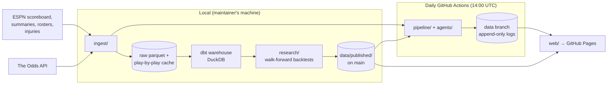

# Architecture

How the project fits together, where each piece lives, and how to add a new one. For the exact
commands that rebuild every number, see [reproduce.md](reproduce.md).

## Data flow



Three kinds of storage, each with one job:

| Where | What | Who writes it |
|---|---|---|
| `$NBAF_DATA_DIR` (local, never pushed) | Raw history: games, box scores, play-by-play cache, stints, the DuckDB warehouse | `nbaf backfill / boxscores / pbp / plays / dbt` |
| `data/published/` on `main` | Small, reviewed outputs: backtest summaries, model files, Cold Case bank | Research commands, merged by PR |
| `data` branch | The public record: predictions, results, scorecards, box scores, shots, stints, ratings | Only the daily job (as `github-actions[bot]`); never rewritten |

## Code layout

```
src/nbaforecast/
├── config.py          paths (repo root, local data dir, published dir)
├── metrics.py         log-loss, Brier and its decomposition, calibration tables
├── warehouse.py       read the local DuckDB warehouse (games, team and player games)
├── attribution.py     CI guard: no AI co-author trailers or bot authors on main
├── ingest/            one module per data source; nothing else talks to the network
│   espn (scoreboard) · backfill · boxscores · playbyplay · injuries · rosters · venues
│   athletes (heights) · odds (The Odds API)
├── models/            pure modeling code; no I/O beyond what's passed in
│   elo · kalman · players (player walk) · hybrid (feature stack, walk-forward fit)
│   impact (RAPM fit)
├── pipeline/          the daily job's steps, each reading/writing the data branch
│   live (results, Elo, predictions, verify) · boxlog (box scores) · court (shots, stints)
│   projections (season simulations) · seasonelo (rating replay) · shadow (hybrid v1)
│   shadow_v2 (hybrid v2: RAPM + injury report)
├── agents/            Claude Code agent jobs: prepare a folder, check the output, publish
│   recap (morning recap + fact-check) · triage (failed-run issues) · availability (injury calls)
├── research/          local backtests that choose models and write data/published/
│   backtest (Elo) · challenger (Kalman, rest) · hybrid_backtest (v1) · impact_backtest (v2)
│   rapm_walk (leak-free RAPM snapshots)
├── games/             coldcase (the daily whodunit's case generator)
├── web/               static site: build · context · charts · filters · fan (teams, colors)
│   players · teams · games · history · play · links · templates/ · static/
└── cli/               `nbaf`: data · research · daily · agents · site (one module per area)
```

**Layers** (an import may only point down; `tests/test_architecture.py` enforces it):
`config`, `metrics` → `ingest`, `models`, `warehouse` → `pipeline` (owns the data-branch layout,
`pipeline/live.Store`) → `agents`, `research`, `games` (independent of each other) → `web` → `cli`.

Other top-level folders: `dbt/` (staging + marts, data tests, seeds for known data issues),
`prompts/` (agent prompts), `scripts/run_agent.sh` (the one agent runner), `tests/` (pytest;
fixtures are saved ESPN JSON, so tests never hit the network), `docs/findings/`
(one write-up per model decision), `.github/workflows/` (CI, daily, pages, agent dry runs).

## Rules that keep it reproducible
- **No leakage.** A feature for a game uses only data from before its tip-off. Backtests are
  walk-forward; RAPM is refit only on earlier games (`research/rapm_walk.py`).
- **Pre-registration.** A model is promoted only by a rule written before its first live
  prediction (`docs/promotion-bar-*.md`), checked mechanically every morning.
- **Append-only record.** `nbaf verify` blocks any change to existing prediction rows, any
  prediction after tip-off, and duplicates, before the daily job commits.
- **Pinned and seeded.** Dependencies are locked (`uv.lock`); simulations and the Cold Case
  bank use fixed seeds. Live inputs (ESPN, odds, agent answers) are logged as they were used.

## Adding something

**A data source.** Add `ingest/<source>.py` with a pure `parse_*` function and a thin `fetch_*`;
save a real response under `tests/fixtures/` and test the parser against it. If it feeds the
daily job, write its output to a new folder on the data branch and add the file to
`pipeline/live.verify` if it must be append-only.

**A model or feature.** Put the math in `models/`, build its features walk-forward, and compare
it in a `research/<name>_backtest.py` against the published model on the held-out seasons
(`research/backtest.HOLDOUT_SEASONS`). Write up the result in `docs/findings/`. To go live, add
a `pipeline/shadow_<name>.py` that logs to `shadow/<name>/<season>.csv`, pre-register its bar,
and add a step to `.github/workflows/daily.yml` (with `continue-on-error`, so it can't block Elo).

**A daily step.** A function in `pipeline/`, a command in `cli/daily.py` (`register` adds the
parser), a step in `daily.yml`. Make it idempotent (catch up on missed days, skip what's done).

**A page.** A module in `web/` that returns the page's data, a template in `web/templates/`,
and a render call in `web/build.py`. Link pages with `web/links.py`. Times are Central.

**An agent job.** Prepare an isolated folder with only the facts the agent needs, run
`scripts/run_agent.sh`, then check the output in code before anything is published or logged.

## Component notes
Details that matter when changing one part. Each component's module docstring has the rest.

**Data and warehouse.** `nbaf backfill` (games since 2004-05), `boxscores` (~3 h; plus-minus
from 2008-09), `pbp` (rebuilds the ~13% of 2012-18 box scores ESPN left blank; used only if
points match and lineups stayed consistent: `docs/findings/pbp-box-rebuild.md`), `plays` (full
play-by-play for RAPM), `dbt build`. ESPN source errors go in `dbt/seeds/known_data_issues.csv`;
duplicate or missing player ids in `dbt/seeds/player_id_aliases.csv`.

**Published model (Elo).** `pipeline/live.py`: adaptive home court
(`docs/findings/elo-backtest.md`). `nbaf daily` ingests results, updates ratings and appends
predictions with `predicted_at`, ratings date and code SHA; `nbaf verify` runs before every
commit. Team pages replay this season from `data/published/elo/season_start_<season>.json`
(`nbaf season-start`, once per season); `pipeline/seasonelo.check` confirms the replay lands on
the live ratings.

**Challengers in shadow.** Both log next to Elo and are judged only by their pre-registered bars.
- *v1* (`pipeline/shadow.py`, `hybrid-realistic-v1`): team history + player production and
  plus-minus, whole roster. Model: `data/published/hybrid/model.json` (`nbaf hybrid-fit`; a
  change is a PR). State on the data branch (`state/hybrid_state.json`), started once with
  `nbaf shadow-bootstrap`.
- *v2* (`pipeline/shadow_v2.py`, `hybrid-lineup-v2`): RAPM offense/defense + production for
  tonight's lineup from the injury report (Out = 0, Day-To-Day = the injury watch's chance) +
  the value of missing minutes (`docs/findings/impact-challenger.md`). Runs after the injury
  calls; no prediction if `players/impact.json` or the directory is missing or stale. Model:
  `nbaf hybrid-v2-fit`; research harness `nbaf impact-backtest` (leak-free RAPM every 14 days,
  `research/rapm_walk.py`, needs `make plays`).

**Player data.** `nbaf box-sync` appends box scores, shot zones and lineup stints from one ESPN
summary per game (`pipeline/boxlog.py`, `pipeline/court.py`); it catches up any missed day.
Nine shot zones; everything inside 14 ft is one zone because the rim/paint split tracks each
arena's scorekeeper. `nbaf impact` refits RAPM daily on this season's and last season's stints
(`models/impact.py`; the site shows `impact.blend`). Defensive role tags (`web/players.py`) need
size, box rates *and* a defense rating that agrees. Career lines: `nbaf careers` (once per
summer). Stat lines are computed only in `pipeline/boxlog.season_line`.

**Agents.** Shared runner `scripts/run_agent.sh` (`AGENT_TOOLS`, `AGENT_MODEL`, `AGENT_OUTPUT`).
- *Recap* (`agents/recap.py`): `recap-prepare` writes facts; the agent drafts; `recap-publish`
  fact-checks or falls back to a template.
- *Injury calls* (`agents/availability.py`): `availability-prepare` scores yesterday's calls
  against box scores and writes today's candidates to `<workdir>/agent/`; the keyword rule's
  answers stay outside it; `availability-publish` validates and appends.
- *Triage* (`agents/triage.py`, `triage.yml`): runs on a failed daily or Pages run and files an
  issue labeled `triage`; fixes go through a normal PR.

**Site.** `nbaf site` renders everything at build time; Pages deploys after every daily run and
every merge to `main`. Pages: Tonight (matchup cards), Standings & odds, Prediction history, The
model, Play (Cold Case), `team-<abbr>.html`, `game-<id>.html`, and the player pop-up
(`static/app.js` loads `players/<id>.json`).
- Logos and headshots load from ESPN's image resizer at view time; `fan.USE_ESPN_IMAGES = False`
  falls back to monograms. Team colors go through `fan.display_color` / `matchup_colors`
  (contrast-checked per theme; `tests/test_fan.py` checks all 30 teams).
- Charts are Vega-Lite specs (`web/charts.py`) with color tokens (`@series-1`) resolved by
  `static/charts.js`; field names must not contain `' . [ ]` (`tests/test_web.py`).
- Live scores (`static/live.js`) poll ESPN in the visitor's browser: display only, never written
  to the data branch, and ESPN's win probability is always labeled as ESPN's.
- Shot charts (`static/court.js`) share zones with `pipeline/court.py`.
- Cold Case: a bank of 365 cases from `nbaf coldcase-bank` (`games/coldcase.py`) in
  `data/published/coldcase/`; the build publishes only through tomorrow's (`web/play.py`).
  Every clue must be checkable on the page.
